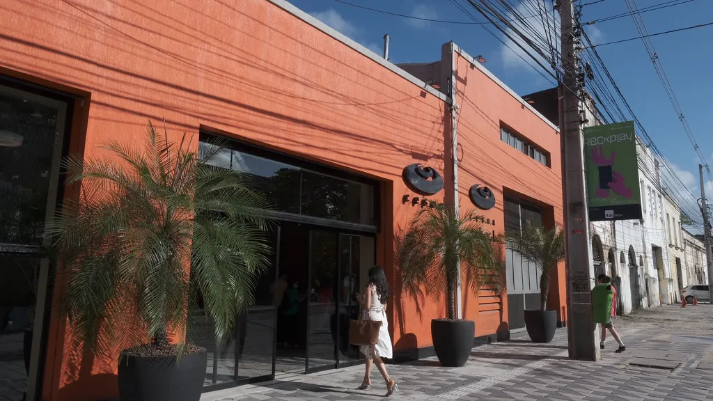
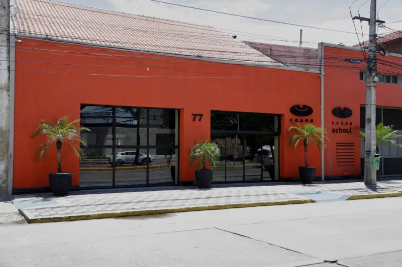
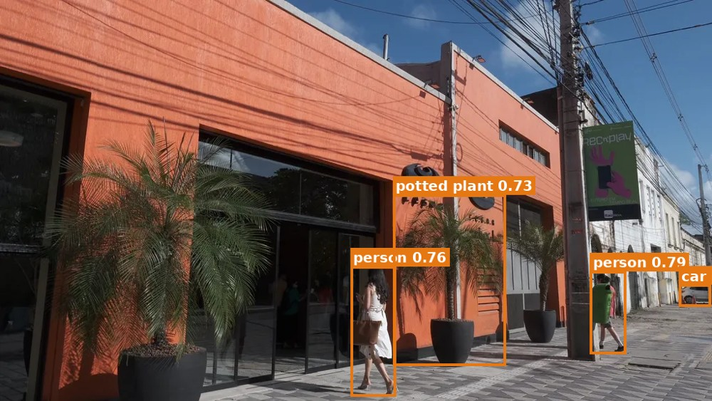
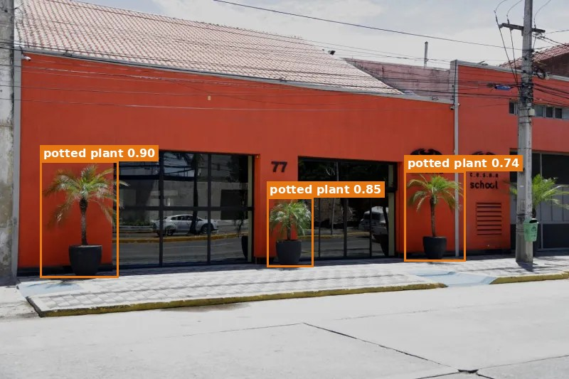
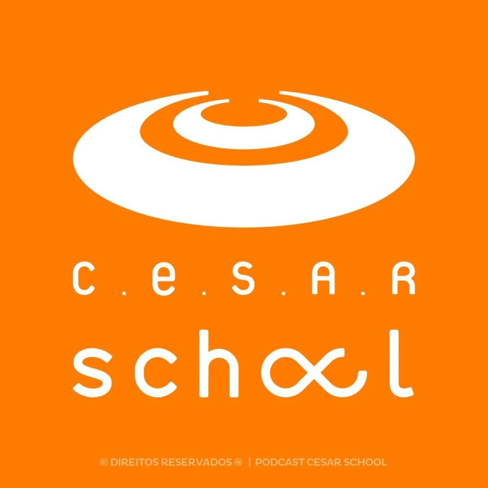

# Novas características de imagem para monitoramento do servidor

**Autor:** Lucas Jerônimo Mendes — Ciência de Dados e Machine Learning, CESAR School

Atividade do projeto [bentoML-processamento-imagens](https://github.com/lgallindo/bentoML-processamento-imagens), com base na aula [011_corpus_histograms_model](https://github.com/lgallindo/bentoML-processamento-imagens/tree/main/011_corpus_histograms_model).

## Enunciado

> Cada pixel tem um valor L, R, G, B, extraímos a média de cada imagem como feature engineering. Que outras características da imagem podemos extrair? Proponha 3 características e use uma ferramenta de IA para extrair essas características de imagens, podem ser numéricas ou categóricas. Mostre a definição das características, o código de extração, três imagens e o resultado final de aplicar o código nessas imagens.

## Contexto

Na aula 011, o `image_extract.py` calcula para cada imagem o histograma dos canais **L**, **R**, **G** e **B** e, a partir dele, a média. O canal L é a luma de `image.convert("L")` no Pillow ([Luma](https://en.wikipedia.org/wiki/Luma_%28video%29)):

```
L = 0.299·R + 0.587·G + 0.114·B
luminance_mean = (Σ i · counts[i]) / (Σ counts[i])
```

Essas médias dizem se a imagem é clara ou escura e para que cor ela puxa. Para monitorar a entrada do servidor elas deixam passar coisas importantes:

- uma foto **desfocada** tem praticamente as mesmas médias da original;
- uma foto com **pouca ou muita cor** pode ter médias R, G, B normais;
- as médias não dizem nada sobre **o que aparece** na imagem.

Por isso propus três características, uma para cada ponto: **nitidez**, **colorido** e **objeto principal**.

## Ferramentas de IA utilizadas

- **YOLO11n (Ultralytics)**: rede neural de detecção de objetos, usada para extrair a característica 3. Roda em ONNX com o `onnxruntime`, só em CPU, sem precisar de PyTorch.
- **Claude (Anthropic)**: assistente usado para ler o código da aula 011, escrever o script de extração e executá-lo nas imagens.

## Definição das características

### 1. Nitidez: variância do Laplaciano (`sharpness`, numérica)

O Laplaciano é um filtro de segunda derivada que responde forte nas bordas e texturas. Aplicado ao canal L, uma imagem nítida gera muitas respostas altas e a variância fica alta. Uma imagem desfocada, com neblina, muito comprimida ou sem textura tem poucas bordas e a variância cai.

```
∇²L = ∂²L/∂x² + ∂²L/∂y²        (kernel [[0,1,0],[1,-4,1],[0,1,0]])
sharpness = Var(∇²L)
```

- Vai de 0 (imagem lisa) até alguns milhares em fotos com muita textura.
- Valores abaixo de ~100 costumam indicar imagem borrada ou sem textura.
- **No monitoramento:** detecta câmera fora de foco, foto tremida, compressão exagerada ou imagens que não são fotos.

### 2. Colorido de Hasler & Süsstrunk (`colorfulness`, numérica)

Usa dois eixos oponentes de cor, a mesma ideia da [crominância](https://en.wikipedia.org/wiki/Chrominance): separar a informação de cor da de brilho.

```
rg = R − G                 (vermelho-verde)
yb = ½(R + G) − B          (amarelo-azul)
colorfulness = √(σ²_rg + σ²_yb) + 0,3 · √(μ²_rg + μ²_yb)
```

- Vale **0** em imagem em tons de cinza, porque R = G = B em todo pixel.
- Pelo artigo original: abaixo de 15 é nada colorida, cerca de 33–45 é moderada, 59–82 é bastante colorida e acima de 109 é extremamente colorida.
- **No monitoramento:** detecta fotos em preto e branco, filtros, cores artificiais ou troca de câmera.

### 3. Objeto principal com YOLO11n (`main_object`, categórica)

A rede YOLO11n foi treinada no dataset COCO e detecta 80 classes (person, car, bicycle, potted plant, dog, boat...). Para cada imagem:

1. a imagem é redimensionada para 640×640 mantendo a proporção (*letterbox*);
2. a rede devolve caixas com classe e confiança;
3. ficam só as detecções com confiança ≥ 0,50, e caixas repetidas são removidas com NMS;
4. o **objeto principal** é a detecção com maior `área × confiança`. Se nada passar do limiar, o valor é `"nenhum"`.

Também guardo `main_object_conf` (a confiança) e `n_objects` (quantos objetos foram detectados).

- **No monitoramento:** é a única característica que olha para o **conteúdo**. Se a distribuição de `main_object` muda ao longo do tempo (por exemplo, aumento de `"nenhum"` ou classes que nunca apareciam), é sinal de *data drift*, mesmo com brilho e cor parecidos.

## Código de extração

Arquivo: [`extract_features.py`](extract_features.py)

O script segue a estrutura do `image_extract.py` da aula: recebe uma `PIL.Image` e devolve um dicionário. Também recalcula as quatro médias da aula pelo mesmo método do histograma, para comparar tudo na mesma tabela.

Trechos principais:

```python
# 1 — nitidez
def sharpness(image):
    gray = np.asarray(image.convert("L"), dtype=np.float64)
    return float(cv2.Laplacian(gray, cv2.CV_64F).var())

# 2 — colorido
def colorfulness(image):
    rgb = np.asarray(image.convert("RGB"), dtype=np.float64)
    r, g, b = rgb[..., 0], rgb[..., 1], rgb[..., 2]
    rg = r - g
    yb = 0.5 * (r + g) - b
    return float(np.sqrt(rg.std()**2 + yb.std()**2) + 0.3 * np.sqrt(rg.mean()**2 + yb.mean()**2))

# 3 — objeto principal (YOLO11n em ONNX)
detector = ObjectDetector()          # carrega models/yolo11n.onnx
dets = detector.detect(image)        # [{"label", "conf", "area_frac", "box"}, ...]
label, conf = main_object(dets)      # maior área × confiança, ou "nenhum"
```

### Como executar

```bash
pip install -r requirements.txt
python extract_features.py imagens/*.webp
```

Na primeira execução o modelo `yolo11n.onnx` (~10 MB) é baixado automaticamente de [ultralytics/assets](https://github.com/ultralytics/assets/releases/tag/v8.3.0) para `models/`.

Saídas:

- [`resultados.json`](resultados.json): todas as características, incluindo a lista de detecções;
- [`resultados.csv`](resultados.csv): a tabela final;
- [`figuras/`](figuras/): as imagens com as caixas detectadas pelo YOLO.

## Imagens utilizadas

São as três imagens de demonstração da pasta [`011_corpus_histograms_model/samples/`](https://github.com/lgallindo/bentoML-processamento-imagens/tree/main/011_corpus_histograms_model/samples) do repositório da aula.

| cesar-fachada-1.webp | cesar-school-fachada-predio-brum.webp | thumb-podcast-cesar-school-1.webp |
|:---:|:---:|:---:|
|  |  |  |
| Fachada em perspectiva, com pessoas na calçada (1024×576) | Fachada de frente, dia claro (800×533) | Logotipo do podcast, arte gráfica (1400×1400) |

Detecções do YOLO11n (caixas laranja):

| cesar-fachada-1 | cesar-school-fachada-predio-brum | thumb-podcast-cesar-school-1 |
|:---:|:---:|:---:|
|  |  |  |
| 2 person, 1 car, 1 potted plant | 3 potted plant | nenhuma detecção |

## Resultados

| imagem | luminance_mean | r_mean | g_mean | b_mean | **sharpness** | **colorfulness** | **main_object** (conf.) | **n_objects** |
|---|---:|---:|---:|---:|---:|---:|---|---:|
| cesar-fachada-1 | 92.67 | 107.80 | 86.95 | 82.52 | 1895.53 | 61.76 | potted plant (0.73) | 4 |
| cesar-school-fachada-predio-brum | 126.17 | 144.72 | 119.02 | 114.36 | 842.56 | 57.74 | potted plant (0.90) | 3 |
| thumb-podcast-cesar-school-1 | 165.41 | 254.72 | 144.39 | 39.65 | **46.02** | **140.53** | **nenhum** | 0 |

### Análise

- **As duas fotos da fachada** têm nitidez alta (1895 e 843) e colorido "bastante colorida" (62 e 58), puxado pelo laranja do prédio e pelo céu azul. O YOLO encontrou objetos coerentes com uma foto de rua: plantas nos vasos da entrada, pessoas e um carro. A primeira é mais nítida porque tem mais textura: fios, folhagem, calçada de pedra e pessoas. A segunda tem grandes áreas lisas de parede e asfalto.
- **O logo do podcast** não chama atenção pela luminância: 165,4 é um valor comum para uma foto clara. As três características novas, porém, mostram que **não se trata de uma foto**:
  - `colorfulness = 140,53` está na faixa "extremamente colorida", por causa do laranja chapado com R ≈ 255 e B ≈ 40;
  - `sharpness = 46,02` é muito baixo. A imagem não está borrada: uma arte gráfica tem grandes áreas lisas e poucas bordas, sem a textura de uma foto real;
  - `main_object = "nenhum"`, porque a rede não reconhece nenhum objeto do mundo real.
- Para o monitoramento, esse é o comportamento desejado. Uma entrada fora do padrão, que as médias L/R/G/B sozinhas não denunciariam, aparece claramente nas três características novas.

### Limitações

- O YOLO11n é o menor modelo da família. Ele erra com objetos pequenos ou parcialmente cobertos, e com limiar baixo (0,35) chegou a confundir uma rocha escura com uma moto em testes com o corpus de praias. Por isso usei 0,50. Para monitoramento, o que importa é a **distribuição** das classes ao longo do tempo, não acertar cada imagem.
- O limiar de nitidez depende do tipo de imagem e deveria ser calibrado pelo corpus de referência (por exemplo, o p05 da nitidez das imagens de treino).

## Como usar no servidor

As três características podem entrar no `features/<stem>.json` da camada 1 da aula 011 e ser agregadas no `corpus_stats.json` da camada 2:

- `sharpness` e `colorfulness`: média e percentis (p05, p50, p95), como já é feito com o brilho;
- `main_object`: contagem por classe.

Na inferência, cada imagem recebida seria comparada com essa referência. Por exemplo: alerta quando a nitidez ficar abaixo do p05 do corpus, ou teste qui-quadrado entre a frequência de `main_object` em produção e no treino.

## Referências

- Repositório da disciplina: [lgallindo/bentoML-processamento-imagens](https://github.com/lgallindo/bentoML-processamento-imagens)
- Wikipedia: [Luma (video)](https://en.wikipedia.org/wiki/Luma_%28video%29) e [Chrominance](https://en.wikipedia.org/wiki/Chrominance)
- HASLER, D.; SÜSSTRUNK, S. *Measuring colourfulness in natural images*. Proc. SPIE 5007, Human Vision and Electronic Imaging VIII, 2003.
- PECH-PACHECO, J. L. et al. *Diatom autofocusing in brightfield microscopy: a comparative study*. ICPR, 2000 (variância do Laplaciano como medida de foco).
- Ultralytics YOLO11: [docs.ultralytics.com](https://docs.ultralytics.com/models/yolo11/)
